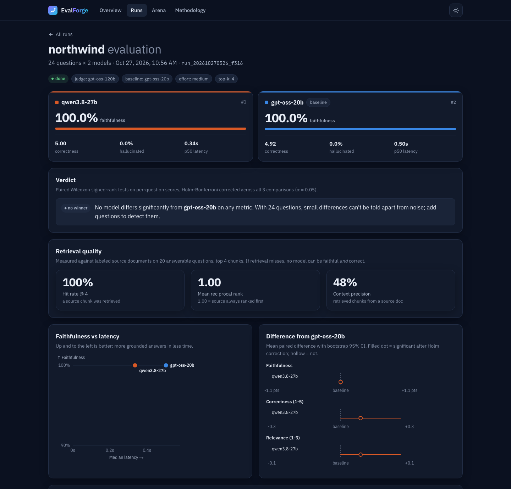

# EvalForge

**Find out whether your RAG model is actually better, and how sure you can be. Runs entirely on free APIs.**

EvalForge runs the same retrieval-augmented question set against several LLMs and grades every answer with an LLM judge at the claim level. It then runs paired significance tests, so "model B is better" comes with a confidence interval and a p-value, not just a higher average.

It works with free providers out of the box: **Groq** (default), **Google Gemini**, **OpenRouter** free models, or fully local **Ollama**. No credit card is required.

The web app has a **live arena**: ask your own question, watch two models stream answers from the same retrieved documents, and see the judge fact-check every claim in real time.


<sub>A real run on Groq's free tier: `gpt-oss-20b` vs `qwen3.8-27b`, judged by `gpt-oss-120b`.</sub>

## Why

Most RAG comparisons look like "Model A: 87%, Model B: 91%, ship B." With 24 test questions, that 4-point gap is often noise. EvalForge answers three questions:

1. **Is it grounded?** Each answer is broken into atomic claims, and every claim is checked against the retrieved context. A claim that's true in the real world but missing from the documents still counts as a hallucination.
2. **Is it really better?** Every model answers the same questions over the same retrieved context, so EvalForge compares *per-question differences* (paired tests) instead of averages.
3. **Is it worth it?** Latency and token usage sit next to quality. Can a fast 8B model match a 70B one on your documents?

## Features

- **Claim-level faithfulness scoring** with an LLM judge using strict JSON-schema structured outputs. It falls back to JSON mode automatically on models without schema support, and every verdict is validated with Zod.
- **Hallucination rate, correctness vs. a reference answer, relevance, and abstention checks.** Does the model say "I don't know" when the answer isn't in the documents?
- **Retrieval metrics.** Label each question with its source documents and EvalForge reports hit rate@k, MRR and context precision, so you can tell a retrieval miss from a model mistake.
- **Live arena.** Visitors ask their own question; both models stream their answers side by side over NDJSON, then the judge's claim-by-claim verdict appears. Rate-limited per IP to protect a free API quota, and falls back to the mock provider when no key is set.
- **Statistics implemented from scratch and checked against SciPy:**
  - Wilcoxon signed-rank test (non-parametric, suited to bounded and ordinal scores)
  - Paired t-test, with the Student's t CDF computed via the regularized incomplete beta function
  - Seeded percentile-bootstrap 95% confidence intervals
  - Holm-Bonferroni correction across every comparison in a run
  - Cohen's d<sub>z</sub> effect size
- **BM25 retrieval** with stemming and section-aware chunking. Dependency-free and inspectable: you can see exactly which chunks each model saw.
- **Built for free-tier limits.** Automatic retry that honors `retry-after` on HTTP 429, low default concurrency, low-effort judge reasoning to save tokens, and `--limit` for quick runs.
- **Dashboard** (Next.js 16, React 19): a landing page with the latest leaderboard, a run report with ranked model cards, verdict summary, retrieval quality, faithfulness-vs-latency scatter, forest plots of effect sizes, and a filterable question matrix (hallucinations, disagreements, unanswerable, retrieval misses) that drills down to claims, the judge's rationale and the retrieved chunks. Dark and light themes, works on mobile, and ships a social preview image for shared links.
- **Deployable.** The dashboard reads your local SQLite database in development and a committed `data/published.json` snapshot in production, so it runs on Vercel's free tier with no database to host.
- **CI regression gate.** `--fail-on-regression` exits non-zero when any model is *significantly* worse than the baseline.
- **Offline mock mode.** Without a key, a deterministic mock provider runs the whole pipeline, so anyone can try it in 30 seconds.

## How it works

```
questions.jsonl ─┐
                 ├─► BM25 retrieve top-k ─► same context to every model
docs/*.md ───────┘                                   │
                                                     ▼
                     ┌──── answer with each model (gpt-oss-20b / qwen3.8-27b / …)
                     ▼
           LLM judge (strict JSON schema)
           claims[] ✓/✗ · relevance · correctness · abstained
                     │
                     ▼
           SQLite (node:sqlite) ─► paired stats ─► CLI table + dashboard
```

**Faithfulness** = supported claims ÷ total claims for each answer. An answer that only abstains makes no claims, so it can't hallucinate.
**Hallucination rate** = share of answers with at least one unsupported claim.

## Quickstart

Requires Node.js 24+.

```bash
git clone https://github.com/<you>/evalforge && cd evalforge
npm install

# Offline demo, no key needed
npm run eval -- --mock

# Real evaluation on Groq's free tier (get a key at https://console.groq.com/keys, no card needed)
cp .env.example .env        # then set GROQ_API_KEY
npm run eval

# Explore the results
npm run dev                 # http://localhost:3000
```

By default, two Groq models (`openai/gpt-oss-20b`, `qwen/qwen3.8-27b`) answer the 24 sample questions, and `openai/gpt-oss-120b` judges. Each Groq model has its own free rate limit. The judge is the bottleneck, so a full run takes about 5 minutes on the free tier. Use `--limit 8` for a quick try.

## Models and providers

Name every model `<provider>:<model id>`:

| Provider | Example | Key | Notes |
|---|---|---|---|
| Groq | `groq:qwen/qwen3.8-27b` | `GROQ_API_KEY` | Free, no card. Very fast. Per-model rate limits. |
| Gemini | `gemini:gemini-3.8-flash` | `GEMINI_API_KEY` | Free tier in AI Studio; check there for which models are free. |
| OpenRouter | `openrouter:<model>:free` | `OPENROUTER_API_KEY` | Models ending in `:free` cost nothing. |
| Ollama | `ollama:gemma4:e4b` | none | Runs on your machine, so it's unlimited and private. |

You can mix providers in one run, for example local models under test with a stronger free cloud judge:

```bash
npm run eval -- --models ollama:gemma4:e4b,groq:qwen/qwen3.8-27b --judge groq:openai/gpt-oss-120b
```

**Choosing a judge:** use the strongest model you have access to. Prefer a judge from a *different* family than the models under test, since LLM judges tend to favor their own family's answers.

## CLI

```
npm run eval -- [options]

  --dataset <dir>          dataset directory (default: datasets/northwind)
  --models <a,b,c>         models as <provider>:<model id> (default: two Groq free-tier models)
  --baseline <model>       model the others are compared against (default: first model)
  --judge <model>          LLM judge (default: groq:openai/gpt-oss-120b)
  --top-k <n>              chunks retrieved per question (default: 4)
  --effort <level>         reasoning effort for reasoning models: low | medium | high (default: medium)
  --concurrency <n>        parallel requests (default: 1, to stay inside free-tier rate limits)
  --limit <n>              evaluate only the first n questions
  --mock                   offline deterministic mode (automatic when a needed key is unset)
  --fail-on-regression     exit 1 if any model is significantly worse than the baseline
```

## Bring your own dataset

```
datasets/my-product/
├── docs/                  # .md or .txt files: the retrieval corpus
│   ├── onboarding.md
│   └── billing.md
└── questions.jsonl
```

```jsonl
{"id": "q1", "question": "How long is the free trial?", "reference": "14 days.", "sources": ["onboarding"]}
{"id": "q2", "question": "Who founded the company?", "unanswerable": true}
```

`reference` is optional (correctness is skipped without one). Mark a question `unanswerable` to test whether models admit they don't know. `sources` lists the document file names (without extension) that contain the answer and turns on the retrieval metrics.

## Deploy

The dashboard and arena deploy to [Vercel](https://vercel.com)'s free tier as a normal Next.js app.

1. Choose which runs the site shows and commit the snapshot:
   ```bash
   npm run export                 # your latest completed live run
   npm run export -- <run id>     # or specific runs (add --only to replace the published set)
   git add data/published.json && git commit -m "Publish results"
   ```
2. Push to GitHub and import the repo at [vercel.com/new](https://vercel.com/new). No build settings need changing.
3. Optional environment variables in the Vercel project:

   | Variable | Purpose |
   |---|---|
   | `GROQ_API_KEY` | Makes the arena call real models. Without it the arena runs in mock mode. |
   | `NEXT_PUBLIC_GITHUB_URL` | Shows a GitHub link in the header. |
   | `ARENA_MODELS`, `ARENA_JUDGE` | Override the arena's models (same `<provider>:<model>` format). |
   | `ARENA_RATE_LIMIT` | Arena questions per IP per 10 minutes (default 6). |
   | `ARENA_DISABLED=1` | Turns the arena off. |

The arena's rate limit is kept in memory per server instance. It protects a free quota from casual overuse, not from a determined attacker; the provider's own limits are the hard cap.

## Design decisions

- **Paired tests over unpaired.** Question difficulty varies far more than model quality. Pairing removes that variance, so a small question set can still detect a sizeable gap. When it can't, the dashboard says so instead of crowning a winner.
- **Wilcoxon as the primary test.** Judge scores are bounded (0-1) or ordinal (1-5), not normal. The t-test is reported alongside for reference.
- **Holm correction.** Three models × three metrics is six comparisons; without correction a false "win" at α = 0.05 is fairly likely.
- **One shared retrieval per question.** Every model and the judge see byte-identical context, so differences come from the model and not from retrieval luck.
- **One OpenAI-compatible client for every provider.** Groq, Gemini, OpenRouter and Ollama all speak the chat-completions API. Provider quirks (strict-schema support, `reasoning_effort`, `<think>` tags) are handled in one place, and each is covered by tests against a fake server.

## Project structure

```
src/
├── cli/
│   ├── eval.ts            # run an evaluation
│   └── export.ts          # publish runs to data/published.json for deployment
├── lib/
│   ├── stats.ts           # Wilcoxon, t-test, bootstrap, Holm (+ tests vs SciPy)
│   ├── retrieval.ts       # chunking, stemming, BM25 (+ tests)
│   ├── providers.ts       # free-tier providers, LLM judge, mock provider (+ tests)
│   ├── prompts.ts         # answer and judge prompts
│   ├── runner.ts          # retrieve → answer → judge pipeline
│   ├── summary.ts         # per-model metrics, comparisons, retrieval quality
│   ├── db.ts              # SQLite persistence
│   ├── store.ts           # reads SQLite locally, the published snapshot when deployed
│   └── arena.ts           # arena config and streamed event types
└── app/
    ├── page.tsx           # landing page with the latest leaderboard
    ├── runs/              # run list, run report, per-question drill-down
    ├── arena/             # live side-by-side arena (client streaming UI)
    ├── api/arena/         # NDJSON streaming endpoint: retrieve → answer → judge
    └── methodology/       # every metric and statistical choice explained
datasets/northwind/        # sample corpus: fictional SaaS handbook
```

## Testing

```bash
npm test          # stats vs SciPy, retrieval recall, provider behavior against a fake API server
npm run typecheck
```

## Roadmap

- [x] Retrieval metrics (hit rate@k, MRR, context precision)
- [x] Live arena with streaming answers and claim-level judging
- [ ] Embedding and hybrid retrieval
- [ ] Judge calibration: agreement with human labels (Cohen's κ), and a multi-judge panel
- [ ] Start runs from the dashboard with live progress
- [ ] Compare prompts and chunking strategies, not just models

## License

MIT
